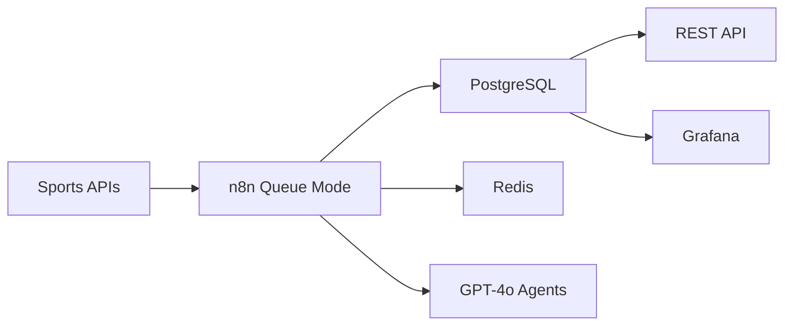

# ⚽ World Cup Intelligence Center (WCIC)

> Real-time sports intelligence platform for the 2026 FIFA World Cup.
> Built with n8n as the main orchestrator, PostgreSQL, Redis and GPT-4o agents.

[](https://github.com/amarialeitao/world-cup-intelligence-center/actions/workflows/ci.yml)
[]()
[]()
[]()
[]()
[]()
[]()

> 🚧 **Work in progress.** The architecture, database schema and workflow specifications are in place, and the workflows are being implemented and tested sprint by sprint. See [Status](#status) for what is built so far.

---

## What is this project?

WCIC is more than an automation: it is a product platform with a distributed architecture that shows how data intelligence systems are built in real corporate environments.

## Motivation

This project was built to practice:

- Automation architecture
- Systems integration
- Data engineering
- Observability
- Applied artificial intelligence
- Event-driven development

The goal was to simulate a product used by sports media and data analytics companies during major sporting events.



**What the system is designed to do:**

- Collects match data from multiple APIs with fallback and deduplication
- Monitors live events (goals, cards, substitutions) with latency under 2 minutes
- Analyzes news with specialized GPT-4o agents and an impact score
- Processes Twitter and Reddit sentiment during matches
- Generates pre-match predictions with probabilities and an auditable rationale
- Publishes a daily report generated automatically by AI
- Exposes everything through an authenticated REST API for external consumers

---

## Architecture in numbers (planned)

| Component | Count |
|---|---|
| n8n workflows | 12 main + 7 subworkflows |
| PostgreSQL tables | 15+ with indexes and materialized views |
| Redis patterns | Cache, Queues, Rate Limiting, Dedup, Circuit Breaker, Pub/Sub |
| AI agents | 4, each with its own responsibility |
| Notification channels | Telegram, Slack, Email, Webhooks |
| Prometheus metrics | 20+ operational and business metrics |

---

## Quick Start

### Prerequisites

- Docker and Docker Compose
- Make (optional, for shorter commands)
- Credentials for the external APIs (see `.env.example`)

### 1. Clone and configure

```bash
git clone https://github.com/amarialeitao/world-cup-intelligence-center.git
cd world-cup-intelligence-center
cp .env.example .env
# Edit .env with your API keys
```

### 2. Start the infrastructure

The `api` service has no code yet (see [Status](#status)), so start the other services:

```bash
docker-compose up -d postgres redis n8n n8n-worker-1 n8n-worker-2 prometheus postgres-exporter redis-exporter grafana metabase
```

### 3. Initialize the database

```bash
./scripts/setup-database.sh
```

### 4. Import the workflows into n8n

```bash
./scripts/import-workflows.sh
```

### 5. Check the API connections

```bash
./scripts/test-apis.sh
```

### Service access

| Service | URL | Credentials |
|---|---|---|
| n8n | http://localhost:5678 | `.env N8N_BASIC_AUTH_*` |
| Grafana | http://localhost:3000 | admin / `.env GRAFANA_ADMIN_PASSWORD` |
| Metabase | http://localhost:3001 | set up on first access |
| Prometheus | http://localhost:9090 | no authentication |
| API WCIC (not built yet) | http://localhost:8080/api/v1 | `X-API-Key` header |

---

## Project structure

```
world-cup-intelligence-center/
├── n8n/
│   ├── workflows/          # Workflows exported from n8n (JSON)
│   ├── subflows/           # Reusable sub-workflows (OpenAI agents)
│   └── specs/              # Readable specifications of each workflow (for code review)
├── database/
│   ├── migrations/         # Versioned SQL (run in order)
│   └── seeds/              # Reference data (teams, venues)
├── dashboards/
│   └── grafana/            # Grafana dashboards
├── docker/                 # Per-service configuration (PostgreSQL, Prometheus)
├── docs/                   # Technical documentation and decisions
├── scripts/                # Setup, import and test scripts
└── docker-compose.yml
```

---

## Documentation

The documents in `docs/` are written in Portuguese.

| Document | Description |
|---|---|
| [ARCHITECTURE.md](./docs/ARCHITECTURE.md) | Full architecture overview |
| [DECISIONS.md](./docs/DECISIONS.md) | ADRs: why each technology was chosen |
| [API_PROVIDER_DECISION.md](./docs/API_PROVIDER_DECISION.md) | How the sports data API provider was chosen |
| [n8n/specs](./n8n/specs) | Readable specifications of each workflow |

---

## Architectural Patterns

- Event Driven Architecture
- Queue-Based Processing
- Circuit Breaker
- Retry with Exponential Backoff
- Dead Letter Queue
- Cache Aside
- API Gateway Pattern
- AI Agent Orchestration
- Observability First

---

## Status

The project is not finished. This is what the repository contains today, by sprint:

| Sprint | Scope | In the repository |
|---|---|---|
| 0 | Base structure and documentation | ✅ Architecture document, ADRs, workflow specifications ([`n8n/specs`](./n8n/specs)) |
| 1 | Database schema | ✅ 8 versioned migrations (schema, indexes, views, TimescaleDB hypertables) and seeds for teams and venues |
| 2 | WF-01 Match Collector + WF-08 Dashboard Sync | WF-01 built · WF-08 not started |
| 3 | WF-02 Live Events + WF-07 Notification Hub | Both workflows built, with a test script for live events |
| 4 | WF-03 News Intelligence + WF-04 Sentiment | Both workflows built, with test scripts and a Grafana dashboard for news intelligence |
| 5 | WF-05 AI Predictions + WF-11 Accuracy Tracker | Both workflows built, with a test script for the prediction engine |
| 6 | Full observability (Grafana + Prometheus) | Prometheus configuration and alert rules in place; remaining dashboards not built |

Still missing for a first complete version:

- 5 of the 12 planned main workflows (including WF-08 Dashboard Sync, WF-09 Data Quality and WF-10 Error Recovery) and 4 of the 7 planned sub-workflows (the 3 OpenAI agent sub-workflows are built).
- The REST API service: it is declared in `docker-compose.yml`, but its code is not in the repository yet.
- The remaining Grafana dashboards and the Metabase setup.

Known issue: on a fresh database, migration `005` cannot create the unique index on `match_events (match_id, external_id)`, because TimescaleDB requires every unique index on a hypertable to include the partitioning column (`created_at`). WF-02 relies on that index for `ON CONFLICT DO NOTHING`, so event deduplication needs a different design before the live event pipeline is complete.

## Continuous integration

- **[CI](.github/workflows/ci.yml)**, on every push: checks that every n8n workflow and Grafana dashboard is valid JSON, that each workflow has a name and nodes, that the shell scripts parse, and that `docker-compose.yml` is valid.
- **[Database](.github/workflows/database.yml)**, run manually for now: starts an empty PostgreSQL 15 + TimescaleDB and runs `scripts/test-migrations.sh`, which applies the init, all migrations in order and the seeds, then checks tables, views, hypertables and seed data. It will run on every push once the known issue above is fixed.

---

## Performance Targets

| Metric | Target |
|----------|----------|
| Event Processing Latency | < 2 min |
| Prediction Generation | < 15s |
| Notification Delivery | < 10s |
| Workflow Success Rate | > 99% |
| API Availability | 99.9% |

---

## Technical Skills Demonstrated

- Workflow orchestration with n8n in Queue Mode (horizontal scaling)
- Integration architecture with multiple APIs and automatic fallback
- Relational schema design for time-series data
- Resilience patterns: Circuit Breaker, Dead-letter Queue, Retry with backoff
- Prompt engineering for AI agents with structured, auditable outputs
- Observability with Prometheus and Grafana in a distributed environment
- Security: webhook validation, rate limiting, secrets management
- Containerization of the full stack with Docker Compose

## License

[MIT](LICENSE)
